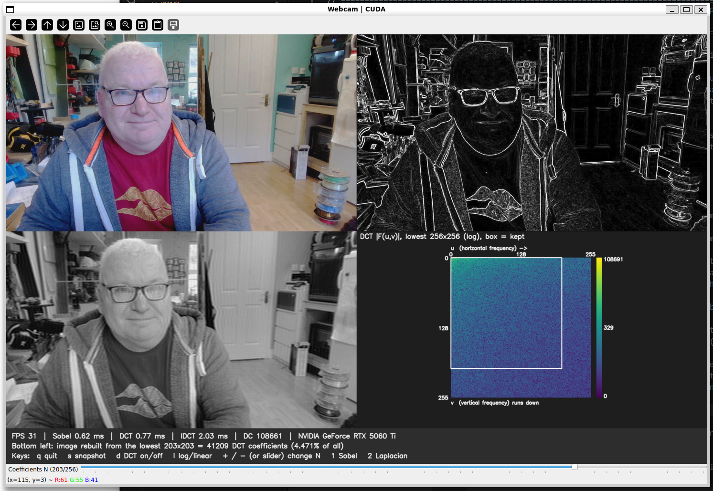

# CUDA Computer Vision and Frequency Domain Explorer

Real-time computer vision, frequency-domain analysis, and image reconstruction using NVIDIA CUDA, OpenCV, and modern C++.

This project captures live video, performs GPU-accelerated image processing, computes a real-time Discrete Cosine Transform (DCT), visualises the resulting frequency spectrum, and reconstructs the image using only selected low-frequency coefficients.

The project was created as part of a broader AI and computer vision learning journey with a focus on understanding the algorithms and GPU implementation techniques that sit underneath modern abstractions.

---

## Why This Project Exists

Modern AI and computer vision frameworks can perform sophisticated operations with a single library call.

While that is incredibly useful, it can also hide the underlying mathematics and implementation details.

The goal of this project is to revisit those fundamentals by implementing the key processing stages directly on the GPU:

- CUDA kernel development
- Edge detection
- Frequency-domain transforms
- Image reconstruction
- GPU memory management
- Real-time streaming pipelines

Rather than calling pre-built DCT routines, the transform is implemented directly using CUDA kernels and separable row/column processing.

> **Implemented from first principles.** While OpenCV provides Sobel, Laplacian, and DCT functionality through library calls, this project implements the core processing directly in CUDA to explore GPU architecture, frequency-domain analysis, and real-time image reconstruction.

---

## Screenshots

### Frequency-Domain Image Reconstruction

images/dct_reconstruction.png

*Reconstructed image generated using only 71×71 low-frequency DCT coefficients (5041 coefficients, approximately 0.55% of the available frequency-domain information) while preserving the overall structure of the scene.*

### CUDA Laplacian Edge Detection

images/laplacian_processing.png

*Real-time Laplacian filtering running on the GPU alongside DCT analysis and IDCT reconstruction. Edge operators can be switched dynamically while video processing continues at interactive frame rates.*

### High-Fidelity Reconstruction



*Increasing the retained coefficient count progressively restores fine image detail while maintaining real-time performance.*

---

## Features

### Real-Time Video Input

Supports:

- Local webcams
- Network video streams
- Windows-to-WSL streaming via FFmpeg

### CUDA Edge Detection

Two GPU-accelerated filters are provided.

#### Sobel Filter

First-derivative edge detector using gradient magnitude.

Useful for:

- Edge extraction
- Shape detection
- Feature identification
- Computer vision pre-processing

#### Laplacian Filter

Second-derivative edge detector using an 8-neighbour convolution kernel.

Useful for:

- Fine edge identification
- Detail enhancement
- Rapid intensity-change detection
- Spatial analysis

---

## Frequency Domain Analysis

The application computes a two-dimensional orthonormal DCT-II directly on the GPU.

Implementation features include:

- Separable row/column transforms
- Pre-computed cosine lookup tables
- CUDA kernel acceleration
- Real-time live video processing
- Interactive coefficient selection

### DCT Visualisation

A dedicated heatmap displays:

- Magnitude of DCT coefficients
- Frequency distribution
- Linear scaling mode
- Logarithmic scaling mode
- Active reconstruction region

The heatmap makes it possible to see how image information is distributed throughout the frequency domain.

---

## Image Reconstruction (IDCT)

The application reconstructs an image using only the lowest *N × N* DCT coefficients.

The coefficient count can be adjusted interactively using:

- Keyboard controls
- On-screen slider

This demonstrates:

- Frequency-domain image representation
- Energy concentration in low frequencies
- Image compression concepts
- Progressive reconstruction

The reconstructed image updates continuously while viewing live video.

---

## Display Layout

The application presents a four-panel dashboard:

| Panel | Description |
|---------|-------------|
| Top Left | Original camera image |
| Top Right | Sobel or Laplacian output |
| Bottom Left | IDCT reconstructed image |
| Bottom Right | DCT coefficient heatmap |

A status bar displays:

- Frames per second
- Edge processing time
- DCT execution time
- IDCT execution time
- Current filter selection
- GPU device information
- Coefficient utilisation statistics

---

## GPU Processing Pipeline

For each video frame:

```text
BGR Camera Frame
        │
        ▼
GPU Upload
        │
        ▼
Grayscale Conversion
        │
        ▼
Sobel / Laplacian Filter
        │
        ▼
2D DCT Analysis
        │
        ▼
Frequency-Domain Visualisation
        │
        ▼
Coefficient Selection
        │
        ▼
Inverse DCT Reconstruction
        │
        ▼
Display & Performance Monitoring
```

---

## Technical Highlights

### CUDA Kernels

Custom CUDA kernels implement:

- BGR to grayscale conversion
- Sobel edge detection
- Laplacian edge detection
- DCT row transform
- DCT column transform
- IDCT column transform
- IDCT row transform

### DCT Implementation

The DCT implementation:

- Uses an orthonormal DCT-II formulation
- Computes transforms using separable row and column passes
- Utilises pre-computed cosine basis tables
- Executes entirely on the GPU

### Performance Measurement

CUDA events are used to measure:

- Edge processing pipeline
- DCT execution
- IDCT execution

allowing real-time profiling of the application.

---

## Development Environment

Developed using:

- Windows 11
- WSL2 Ubuntu
- Visual Studio Code
- CMake
- NVIDIA CUDA Toolkit
- OpenCV 4
- GDB

---

## Build

### Prerequisites

- NVIDIA GPU with CUDA support
- CUDA Toolkit
- OpenCV 4
- CMake 3.18+
- GCC/G++ with C++17 support

### Compile

```bash
mkdir build
cd build

cmake ..
cmake --build .
```

Build output:

```bash
./webcam
```

---

## Running

### Local Webcam

```bash
./webcam
```

or

```bash
./webcam 0
```

### Network Stream

```bash
./webcam tcp://HOST:5000
```

### Environment Variable

```bash
export WEBCAM_SOURCE=tcp://HOST:5000
./webcam
```

---

## Windows to WSL Video Streaming

Development and testing were performed using a Windows-hosted webcam streamed into WSL via FFmpeg.

Pipeline:

```text
Windows Webcam
       │
       ▼
FFmpeg
       │
       ▼
TCP Video Stream
       │
       ▼
OpenCV VideoCapture
       │
       ▼
CUDA Processing Pipeline
       │
       ▼
Real-Time Visualisation
```

This approach provides reliable webcam access while maintaining the development workflow entirely inside WSL.

---

## Controls

| Key | Action |
|--------|--------|
| q / ESC | Quit application |
| s | Save snapshot |
| d | Enable / disable DCT processing |
| l | Toggle logarithmic / linear heatmap scaling |
| + | Increase retained coefficients |
| - | Decrease retained coefficients |
| 1 | Select Sobel filter |
| 2 | Select Laplacian filter |

---

## Educational Objectives

This project was built to explore and demonstrate:

- CUDA programming fundamentals
- GPU memory management
- Parallel processing techniques
- Computer vision algorithms
- Frequency-domain analysis
- Digital signal processing concepts
- Image compression principles
- Real-time processing architectures

The emphasis is on understanding the underlying implementation rather than relying solely on high-level abstractions.

---

## Future Work

Planned extensions include:

- Neural network implementation from first principles
- Additional image-processing kernels
- GPU feature extraction
- Classification experiments
- Edge AI deployment studies

---

## License

This project is licensed under the MIT License. See the LICENSE file for details.

---

## Author

**Matthew Roche**

Part of an ongoing exploration into Artificial Intelligence, Machine Learning, Computer Vision, CUDA, TinyML, and Edge AI.

*"The best way to understand an abstraction is to build what sits underneath it."*
